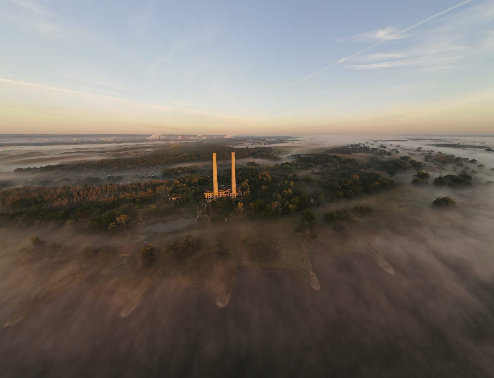

<figure class="article-image">
  
  <figcaption>Die Ruine des Kraftwerks Vogelsang bei Eisenhüttenstadt im Morgennebel, aus der Luft. (Foto: Stefan Lehmann)</figcaption>
</figure>

## Zwei Schlote über dem Oderbogen

Februar 1945

Rund drei Kilometer vom Ort Vogelsang entfernt, bei Fürstenberg, steht das Kraftwerk Vogelsang, ein Neubau, der nie Strom geliefert hatte. Seit Anfang Februar 1945 lag es im sowjetischen Brückenkopf am Westufer der Oder. In den beiden 110 Meter hohen Schornsteinen saßen sowjetische Artilleriebeobachter, vor ihnen lag jede Stellung in Vogelsang offen.

SS-Untersturmführer Polle, Zugführer der Pioniere im Regiment „Schill“, kannte diese Schornsteine. Am 14. Februar war sein Zug beim ersten Stoßtrupp gegen das Kraftwerk dabei, an der Reichsstraße 112 wurde er zusammengeschossen. Nur sieben Mann kamen unverwundet zurück. Später schrieb Polle:

> „Seit Tagen machten uns die russischen VB in den Schornsteinen des E-Werks von Fürstenberg zu schaffen. Sie konnten das Feuer auf unsere Stellungen, bis weit in das Hinterland beliebig lenken.“

Flak und eine [Mistel](/artikel/huckepack-kommt-der-tod.html) der Luftwaffe hatten nichts ausgerichtet. Nun sollte ein verstärkter Pionierstoßtrupp die Kamine sprengen, „aber dazu mußte man erst einmal den russischen Brückenkopf bis zum Oderdamm zurückdrängen.“

Wie die Schornsteine über dem Land stehen, zeigt das Video aus der Luft.

## Der Befehl des 5. SS-Gebirgskorps

Ein Angriff in drei Wellen

Vogelsang selbst war zu drei Vierteln in sowjetischer Hand, überrannt während einer Formalausbildung an der Hauptkampflinie. Nach SS-Standartenoberjunker Wilke, Nachrichtenoffizier im Regiment „Schill“, befahl das 5. SS-Gebirgskorps unter SS-Obergruppenführer Jeckeln, den Ort zurückzuerobern und den Brückenkopf bis Fürstenberg zu beseitigen, samt Kraftwerk. Die beiden Grenadierbataillone hatten zusammen höchstens noch 200 einsatzfähige Männer.

Das Korps plante deshalb in zwei Schritten und in drei Wellen. Vorneweg die Pionierzüge der Regimenter „Schill“ und „Kurmark“ und zwei Sturmzüge mit dem neuen Sturmgewehr, dazu sechs ferngelenkte Sprengfahrzeuge vom Typ Goliath. Dahinter eine Sicherungskompanie des Korps, die Begleitkompanie der Division, eine Kompanie des Feldersatzbataillons und der Rest des 1. Bataillons. Feuern sollten das ganze Artillerieregiment der Division, zwei Werferabteilungen, Vielfachwerfer, schwere Mörser des Heeres und die Flak. Auf dem Papier stand hinter 200 Grenadieren ein ganzes Artillerieregiment.

Die Gliederung der drei Wellen macht der Lagetisch im Video sichtbar.

## Häuserkampf an Scheunen: Die Übung in Schernsdorf

Eine Kritik kostet das Kommando

In der Nahkampfschule Schernsdorf übten die Männer der ersten Welle etwa drei Tage lang unter Polles Führung, an einem Modell, an Scheunen und Attrappen, die meisten von ihnen keine Pioniere. Vogelsang dagegen bestand aus ausgebrannten Einfamilienhäusern mit Kellern an der Reichsstraße 112, zerfetzten Freileitungen, zwölf Panzerwracks und einer Panzersperre in der Ortsmitte. Die Scheunen von Schernsdorf schossen nicht zurück.

Bei der Schlussübung fanden die Gruppen nicht zum Stoßkeil zusammen. Divisionskommandeur SS-Oberführer Ax meinte dennoch, alles habe „ganz vorzüglich geklappt“. Polle widersprach, nannte die Fehler und verlangte, auch die Kommandeure sollten sich Vogelsang selbst ansehen. Noch vor den Versammelten wurde er als Stoßtruppführer abgesetzt. Als auch die übrigen Zugführer die Fehler meldeten, forderte ihr Bataillonskommandeur die Sturmzüge zurück, der Lehrgang wurde abgebrochen. Über die weiteren Pläne herrschte „tiefes Schweigen“.

Schlussübung und Widerspruch schildert das Video ausführlicher.

## Die Besprechung in Seelas-Hof

2. bis 10. März 1945

Am Abend des 2. März trafen sich Jeckeln, Ax, die Regimentskommandeure und Artilleriekommandeur SS-Obersturmbannführer Hufmann im Regimentsgefechtsstand Seelas-Hof, einem Birkenwald nördlich von Schönfließ. Angriffsbeginn: 6.15 Uhr. Auf der Rückfahrt stieß Hufmanns Wagen mit einem Sanitätskraftwagen zusammen, er wurde tödlich verletzt. Sein Regiment wechselte in kurzer Zeit zweimal den Kommandeur. Artillerie, Flak und Werfer erfuhren nie, was ihnen zugedacht war, und offenbar prüfte keine Kommandostelle nach.

Am 3. März vereinigte die sowjetische Seite ihre Brückenköpfe bei Aurith und Vogelsang. Bis zum Angriff vergingen neun Tage, warum, überliefert keine Quelle.

Am 10. März spät abends kam Nachersatz aus Stendal, Panzergrenadiere, eigentlich bestimmt für die SS-Panzerdivision „Hohenstaufen“ am Plattensee. In Grunow mussten sie ihre Soldbücher abgeben, je 30 Mann kamen zu jeder Kompanie und standen gegen 3 Uhr in der HKL. Drei Stunden später sollten Männer angreifen, die einander nicht kannten.

Den Weg des Ersatzes von Stendal an die Oder verfolgt das Video genauer.

## Der große Stoßtrupp stirbt

11. März 1945, 6.15 Uhr

Die vorgeschobenen Beobachter der deutschen Artillerie fehlten, der Feuerschlag blieb aus. Erst auf Nachfrage fielen zweimal sechs Granaten. Damit, schreibt Wilke, weckte die deutsche Artillerie die sowjetische Seite „nun vollends“ auf.

Pioniere und Grenadiere sprangen in die sowjetischen Gräben und schalteten die ersten Maschinengewehrstellungen aus. Dann flogen ihnen die verminten Häuser um die Ohren, das Gegenfeuer machte jede Bergung unmöglich. Sanitäter SS-Rottenführer Harald Schmidt wurde dabei durch Kopfschuss verwundet. „Alles lag fest“, schreibt Wilke. „Es ging nichts mehr!“ Nach etwa zehn Minuten kam über Funk der Befehl zur Rückkehr.

Die zehn Minuten erzählt das Video Schritt für Schritt.

## „Bei Vogelsang ist die Sache gut gelaufen“

Bilanz eines Morgens

Das 1. Bataillon des Regiments „Schill“ und die beiden Pionierzüge verloren die Hälfte ihrer Männer, der Gräberunteroffizier zählte allein beim Regiment 67 Tote. Viele waren kaum zu identifizieren: Männer des Nachersatzes, ohne Soldbuch und Erkennungsmarke.

Um 11.25 Uhr hieß es im Ferngespräch mit der Heeresgruppe Weichsel: „Bei Vogelsang ist die Sache gut gelaufen.“ Am Abend meldete sie: „Der weitere Angriff zur restlosen Inbesitznahme von Vogelsang schlug nicht durch.“ Der Brückenkopf blieb bis zur Offensive am 16. April sowjetisch. Das Kraftwerk steht bis heute, mit beiden Schornsteinen.

Die Originalakten der Heeresgruppe sind im Video zu sehen.

