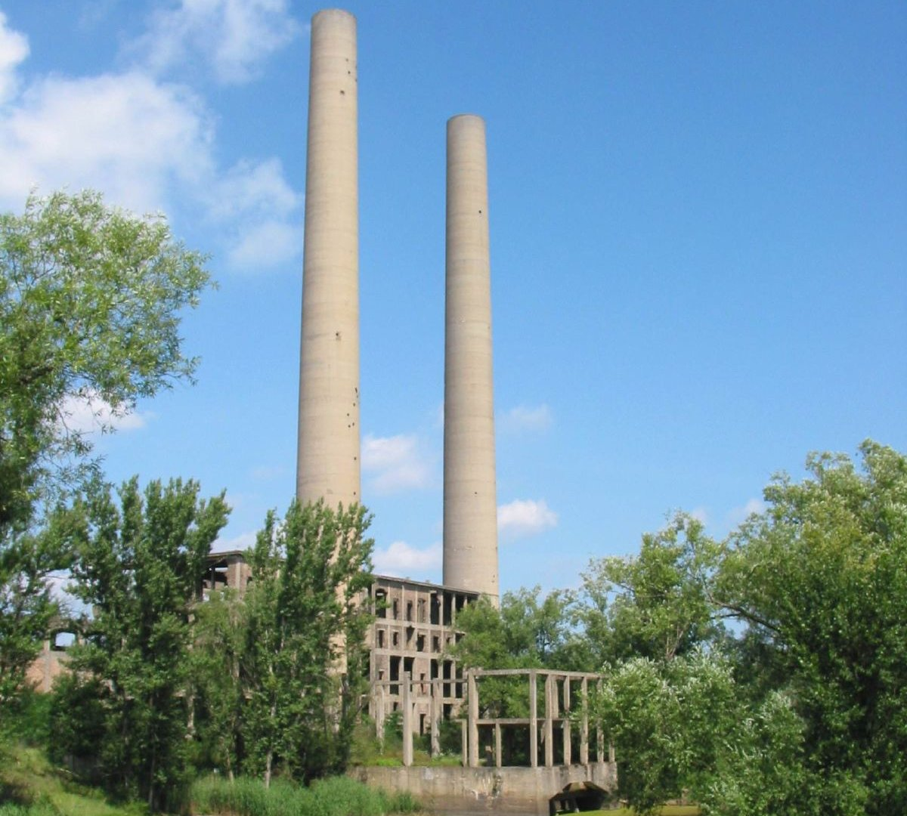

<figure class="article-image">
  
  <figcaption>Die Ruine des Kraftwerks Vogelsang in Fürstenberg, heute Eisenhüttenstadt, im Juli 2007. (Foto: Charlotte Nordahl, <a href="https://commons.wikimedia.org/wiki/File:Kraftwerk_Vogelsang_2007.jpg" target="_blank" rel="noopener">Wikimedia Commons</a>, <a href="https://creativecommons.org/licenses/by-sa/2.0/deed.de" target="_blank" rel="noopener">CC BY-SA 2.0</a>, Ausschnitt)</figcaption>
</figure>

## Eine Division aus Schulen und Lagern

Die 32. SS-Division „30. Januar“ entsteht

Die Aufstellung der 32. SS-Freiwilligen-Grenadier-Division wurde am 30. Januar 1945 befohlen, nach diesem Tag erhielt sie ihren Namen. Zehn verschiedene Einheiten bildeten sie: Kadetten aus Schulen, Ersatzeinheiten, Wach- und Polizeikräfte aus den Konzentrationslagern Dachau und Buchenwald, dazu Männer aus Luftwaffe und Kriegsmarine. Rund drei Viertel gehörten den Jahrgängen 1925 bis 1927 an. Die Werferbatterie besaß nur 90 Wurfkörper und wurde am 25. Februar aufgelöst.

Zur Division gehörte das SS-Pionierbataillon 32, rund 200 Mann und etwa 30 Unterführer, wahrscheinlich alle von der SS-Pionierschule Hradischko. Am 28. Januar brach der Transport im böhmischen Beneschau auf, um Posen zu entsetzen, und wurde am 5. Februar über Guben in Neuzelle an der Oder ausgeladen. Beim ersten Einsatz am Oder-Spree-Kanal bei Rautenkranz fiel die Holzbrücke bei der Sprengung nur von ihren Fundamenten und blieb benutzbar.

Den Weg der Pioniere erzählt das Video ausführlicher.

## Vogelsang und das Kraftwerk: Der kleine Ort mit hohen Schloten

6. und 7. Februar 1945

Sowjetische Truppen besetzten Vogelsang in den ersten Februartagen 1945. Am 6. Februar griff die Division den Ort erstmals an, am Tag darauf nahmen das erfahrene I. Bataillon des SS-Freiwilligen-Grenadier-Regiments 86 „Schill“ und die Panzerjägerabteilung ihn zurück. Von den Einfamilienhäusern entlang der Reichsstraße 112, vor den Kämpfen Heimat von rund 600 Einwohnern, waren mehrere ausgebrannt, dazwischen standen zwölf Panzerwracks. Laufgräben gab es nicht, die Männer lagen meist in den Kellern.

Bei Fürstenberg stand das Kraftwerk Vogelsang, ein Neubau der Märkischen Elektrizitätswerke, der nie in Betrieb ging. Die Arbeiten waren am 31. Januar 1945 eingestellt worden. In den beiden 110 Meter hohen Schornsteinen richtete die Rote Armee Beobachtungsstellen ihrer Artillerie ein. Von dort lag jede Bewegung auf deutscher Seite offen, auch im drei Kilometer entfernten Vogelsang.

Die Sicht der Beobachter ordnet das Video ein.

## Der Angriff auf das E-Werk

14. und 15. Februar 1945

Am 14. Februar befahl der Kommandierende General des V. SS-Gebirgskorps, SS-Obergruppenführer Krüger, den Angriff auf das Kraftwerk. Um 9 Uhr traten Teile des SS-Pionierbataillons 32 an, dazu der Aufklärungszug des Regiments „Schill“ und ein Zug der SS-Kompanie Heyer. Auf Höhe der Reichsstraße 112 geriet der Stoßtrupp in flankierendes Feuer, dann stießen sowjetische Kräfte aus einem Steinbruch vor. Vom Pionierzug des Untersturmführers Polle kamen sieben Mann unverwundet zurück. Die deutschen Verluste betrugen 82 Tote.

Am nächsten Morgen trat das Bataillon gegen Wiesenau an. Horst Woyciniuk, vorgeschobener Beobachter der Divisionsartillerie, sah, wie die Männer im Feuer sowjetischer Scharfschützen liegen blieben. Am Abend notierte er:

> „Wiesenau ist nicht genommen worden. So werden wir es nie bekommen.“

Gefallen waren der Bataillonskommandeur SS-Hauptsturmführer König, sein Adjutant, der Chef der 1. Kompanie und die Hälfte der Männer. Am 16. Februar meldete SS-Obersturmbannführer Gottmann an Heinrich Himmler, Oberbefehlshaber der Heeresgruppe Weichsel, die Einheiten stimmten sich kaum ab und niemand kenne das Gelände.

Den Ablauf beider Angriffe schildert das Video Zug für Zug.

## Flak und Mistel gegen die Schornsteine

Geballte Kraft wird zur Theaterprobe

Die Beobachter lenkten das Feuer bis weit ins Hinterland, sie auszuschalten wurde vordringlich. Eine 8,8-cm-Flak schoss im direkten Richten auf die Schornsteine, ohne Erfolg. Dann setzte die Luftwaffe eine [Mistel](/artikel/huckepack-kommt-der-tod.html) ein: eine unbemannte, mit rund 2,5 Tonnen Sprengstoff beladene Ju 88, auf ihrem Rumpf ein Jagdflugzeug. Wegen der sowjetischen Flak klinkte der Pilot zu früh aus. Die Chronik der Pioniere spricht von einer „Theaterprobe“ der Luftwaffe.

Den Anflug eines solchen Gespanns beschreibt das Video genauer.

## Nebel über dem Oderbogen

28. Februar 1945

Das Regiment „Schill“ unter SS-Obersturmbannführer Eccher hielt einen Kilometer langen Oderbogen zwischen Vogelsang und Fürstenberg. Seine Männer waren Lagerwachen, SS-Rekruten, Volkssturmmänner und Kadetten, meist nur in den Grundlagen ausgebildet. Das sowjetische 16. Schützenkorps der 69. Armee sollte Bogen und Deich als Ausgangsstellung für die Frühjahrsoffensive nutzen.

In der Nacht zum 28. Februar lag dichter Nebel über der Oder. Um 3 Uhr schalteten Stoßtrupps die deutschen Posten lautlos aus, binnen einer Stunde setzte ein ganzes Regiment mit Pak, Haubitzen und fünf leichten Panzern über. Um 7 Uhr eröffneten rund 25 Batterien das Feuer, um 7.40 Uhr griffen zwei Regimenter der 383. Schützendivision im Süden an. Beide Bataillone des Regiments „Schill“ wurden zerschlagen. Aus dem Oderbogen wurde ein Brückenkopf für die sowjetische Offensive im April.

Das Video folgt dieser Nacht genauer.

## Der Kommandeur aus Prag: Formalausbildung zerreißt die Front

Zwei Tage im Blickfeld der Schornsteine

Hohe Ausfälle brachten schlecht ausgebildeten Ersatz, bis Mitte März hatte die Division vier Kommandeure.

Bei den Panzergrenadieren des Regiments „Schill“ übernahm ein neuer Kommandeur aus Prag, sein Name ist nicht überliefert. Er ordnete sogleich Formalausbildung an und zog die Männer dafür aus der Hauptkampflinie (HKL) heraus. Vorn blieb nur jedes zweite Maschinengewehr besetzt, ein einziger Zug hielt den ganzen Abschnitt. Die Übungsfläche lag gut einsehbar im Blickfeld der Schornsteine.

Zwei Tage lang sahen die sowjetischen Beobachter zu. Dann griffen sowjetische Truppen mitten in die Ausbildung an und rollten genau diesen Abschnitt auf. Die Grenadiere zogen sich überhastet bis zur Panzersperre in der Ortsmitte zurück. Im Gegenstoß schoss eine Gruppe unter SS-Untersturmführer Seligmann drei T-34 ab. Am 2. März musste Vogelsang zu drei Vierteln geräumt werden. Der Kommandeur wurde sofort abgelöst und zum Feldersatzbataillon versetzt.

Wie die Front aufriss, zeigt das Video.

## Der deutsche Gegenangriff auf Vogelsang

Kleckerangriffe und das Ende des Kommandeurs

Zwei Tage später befahl die Division den Gegenangriff. Unterscharführer Scheer hielt den Tag in wenigen Zeilen fest:

> „Um 7 Uhr erster Angriff mit Panzern. Der zweite Angriff wird auf 11 Uhr, später auf 13 Uhr festgesetzt. Wir bauten ca. 50 Minen aus. Der Angriff blieb liegen.“

Die sowjetische Abwehr schoss sich auf die einzeln vorgetragenen „Kleckerangriffe“ ein, das Regiment verlor an diesem Tag 69 Soldaten. Anfang Februar hatte die Division rund 6.000 Mann gemeldet, am 17. März lag ihre Kampfstärke bei 2.846. Die Schornsteine standen noch immer.

Der Kommandeur aus Prag wurde dem Vernehmen nach etwa sechs Wochen später, als er erneut junge Soldaten zur Formalausbildung befohlen hatte, in einem Brandenburger Kiefernwald bei Riesen erschossen.

Die vollständige Einordnung gibt es im Video.

## Quellen und abweichende Angaben

Was die Überlieferung offenlässt

Die Angaben stützen sich vor allem auf die Chronik einer Pioniereinheit und auf A. Stephan Hamilton: „The Oder Front 1945“, Band 2. Für den Angriff auf das Kraftwerk nennt die Chronik den 14. Februar und 82 Tote, Hamilton den 10. Februar und 80 Mann Verlust. Die Höhe der Schornsteine gibt die Chronik mit 110 Metern an, heutige Beschreibungen mit 100 bis rund 120 Metern. Anfang März spricht die Chronik von drei Vierteln Vogelsangs, Hamilton von zwei Dritteln.

Die vollständige Quellenliste steht in der Videobeschreibung.

